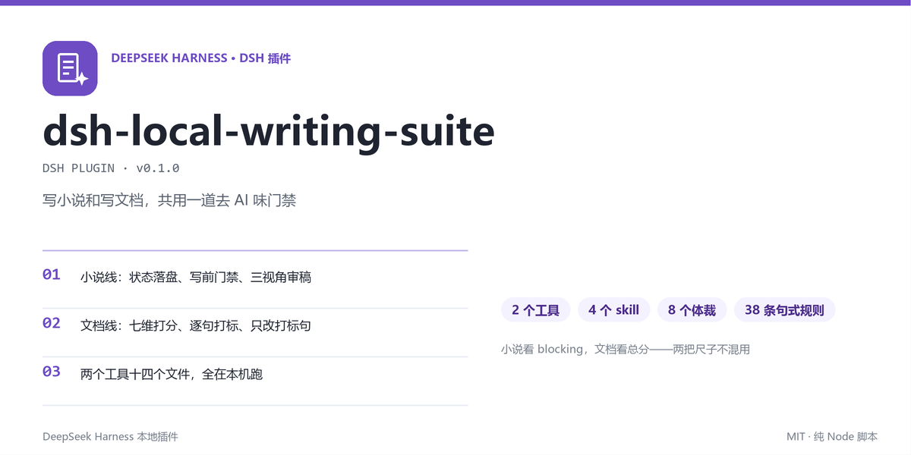

# dsh-local-writing-suite



> DSH 本地插件。2 个工具、4 个 skill，小说线和文档线共用一道门禁。

第 40 章的坑往往来自第 12 章。这件事交给状态文件。

交付件被说一眼 AI，多半是句式问题。这件事交给七维打分。


## 1. 它是什么

装进 DSH 后多出 2 个工具、4 个 skill，全程本机运行，联网次数 0。

| 组成 | 干什么 |
| --- | --- |
| `deai_audit` | 七维打分，逐句打标，带行号与门禁结论 |
| `deai_audit_config` | 管配置：看、列、写、恢复默认 |
| `writing-suite` | 入口路由，2 条线：小说、文档 |
| `novel-write` | 开书到续写，按章推进 |
| `novel-review` | 机器 lint 打底，再走 3 视角人读 |
| `doc-review` | 7 类文档：简历到标书 |
| `scripts/story-state.mjs` | 状态权威，跨会话恢复章号与伏笔 |

## 2. 快速开始

```bash
node install.mjs
```

`install.mjs` 做 4 件事，重复执行安全。

1. 备份 profile 的 `package.json` 到 `~/.dsh/backups/`
2. 复制插件到 `~/.dsh/local-plugins/dsh-local-writing-suite`
3. 挂 `link:` 依赖，建 1 个 node_modules junction
4. 复制 4 个 skill 到 `~/.dsh/skills/`

装完重启 DSH。工具在进程启动时注册，热更目录不会重载。

回归验证跑 1 条命令，12 个样例全 PASS：

```bash
node tests/smoke.mjs
```

## 3. 两个工具

### deai_audit

| 参数 | 取值 | 说明 |
| --- | --- | --- |
| `text` | 字符串 | 整章传，行号才对得上上下文 |
| `genre` | 8 个体裁 | `fiction` 给小说，其余给文档 |
| `detail` | `summary` / `full` | `full` 多给每条命中的改写方向 |

返回 4 块数据，含 `flags[]`。

每条 flag 带 4 个字段，其中 `line` 指向行号。

七个维度里，前 6 个沿用旧算法，第 7 维（套路句式）是这次为小说加的，只数确定性句式。

### deai_audit_config

支持 4 个动作，最常用的是 `get` 和 `set`。

`set` 会整体替换 `genres` 数组，写之前先 `get` 一份。

## 4. 两把尺子，别混用

| 稿件 | 判据 | 为什么 |
| --- | --- | --- |
| 小说（`fiction`） | `counts.blocking == 0` | 节奏慢不是硬伤，套话才是 |
| 文档（其余 7 类） | 总分 ≤ 25，且无 blocking | 结构与空泛词比句式更致命 |

小说可以总分 40、阻断项 0，照样能发。反过来说，25 分但有 3 条套话，不能发。

## 5. 小说状态文件

长篇靠文件，不靠聊天记录。写前读状态卡，写完提交，`check` 拦 3 种硬伤。

```powershell
$S = "$env:USERPROFILE\.dsh\local-plugins\dsh-local-writing-suite\scripts\story-state.mjs"
node $S status --dir <项目>
node $S check  --dir <项目>   # 有阻断时 exit 1
```

`追踪/_state.json` 是唯一权威，`追踪/上下文.md` 由它整份重渲染。

手改派生文件，`check` 会报漂移。

## 6. 实测

`node tests/smoke.mjs` 输出 12 条，前 6 条：

| 样例 | 分数 | blocking |
| --- | --- | --- |
| 小说 AI 腔 | 55.6 | 10 |
| 小说干净文本 | 6.3 | 0 |
| 对照·威压（AI 腔 / 自然） | 45.6 / 7.5 | 5 / 0 |
| 对照·打脸（AI 腔 / 自然） | 38.9 / 7.5 | 5 / 0 |
| 对照·决断（AI 腔 / 自然） | 26.3 / 13 | 3 / 0 |
| 简历标签体 | 62.1 | 3 |

后 3 条对照是同一场戏的两种写法。AI 腔版本靠抽象判词定性，自然版本只用动作和物件。

两者分数差 20 到 40 分。

## 7. 目录结构

```
dsh-local-writing-suite/
  index.js                    七维引擎 + 2 个工具
  config/deai-config.json     8 个体裁 + 38 条 fiction 规则
  scripts/story-state.mjs     状态机
  skills/                     4 个 SKILL.md
  references/                 句式库 34 条 + 2 份 schema
  tests/smoke.mjs             12 个样例
  install.mjs                 幂等安装
```

## 8. 常见问题

**装完没看到 `deai_audit`？** 重启 DSH，工具在启动时注册。

**`genre: "fiction"` 报参数错？** 装的是旧版，它只有 6 个体裁。改依赖指向本插件再重启。

**小说分数很高，读着没问题？** 看 `counts.blocking`。总分里 2 维是文档口径，对小说只当趋势。

**改完配置 `fiction` 不见了？** `set` 是整体替换，先 `get` 再改。

**能审英文吗？** 规则表是中文句式，英文只能拿 2 个维度作参考。

## 9. License

MIT。句式规则整理自公开的网文 AI 腔讨论与写作教材，未收录未经授权的原文片段。
